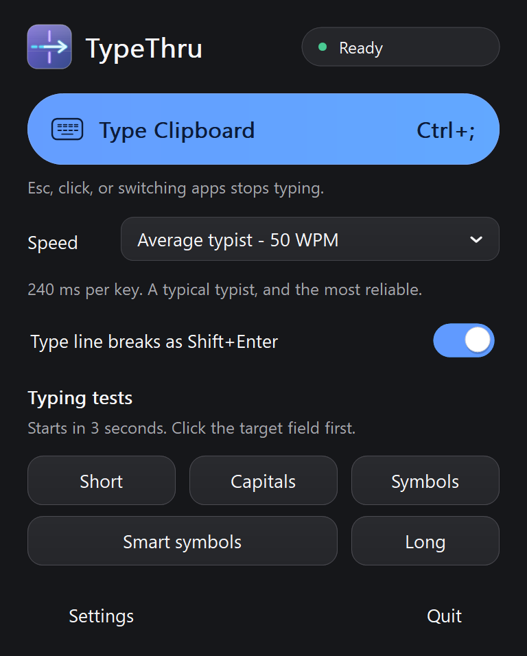
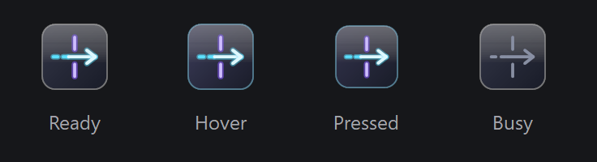

# TypeThru 0.2.1 — visual refresh

This revision follows the macOS panel's hierarchy and brand: a prominent capsule
action, compact speed row, right-aligned switches, five direct typing-test buttons,
quiet footer actions, and grouped Settings rows.

The previous dark-mode defect came from mixing custom dark parent surfaces with
stock checkbox/combo painting. Toggle and combo painting now use the same palette
as the rest of the app. They retain their native Win32 control classes, checkbox
state, keyboard handling, notifications, and accessibility semantics.

Rounded shapes, the keyboard glyph, and the cyan/violet TypeThru mark use
antialiased GDI+. The icon is generated from the same mark at 16–256 pixels and
embedded in the app and its window titlebar. Hover/switch transitions take 120 ms
and respect high contrast and the system's client-area animation preference.
Bright accent surfaces use navy text for readable contrast (6.09:1 on the base
accent); high contrast uses system colors.

## Previews

These are **offline renders of the production drawing functions**, using the same
layout coordinates, fonts, labels, and speed text as the app. They show example
default states and the full logical client area. They do not represent a live
window, an exercised typing action, or verified native popup behavior.

| View | Dark | Light |
| --- | --- | --- |
| Main panel | [Preview](previews/panel-dark.png) | [Preview](previews/panel-light.png) |
| Settings | [Preview](previews/settings-dark.png) | [Preview](previews/settings-light.png) |



## Reproduce without interacting with the desktop

```bat
scripts\build.cmd preview
.build\RenderUI.exe .build\previews
```

The renderer creates memory bitmaps only. It does not create app windows, read the
clipboard, register hooks/hotkeys, contact the network, or send keyboard input.
`src/ui_layout.h` supplies shared layout and static labels; `src/ui.cpp` supplies
the painting; `tools/render-ui.cpp` composes the previews. Passing a second path
to the renderer writes a regenerated multi-resolution icon there.

Before release, the owner still needs to verify native dropdown selection/closing,
switches with mouse and Space, shortcut recording, high contrast and theme changes,
different DPI displays, screen-reader behavior, panel nonactivation, and real
typing. See [the acceptance checklist](MANUAL-TESTS.md).

Validation: the final full build passed `/W4 /WX` with 173 tests and zero failures.
The offline renderer compiled cleanly and all dark/light previews above were
visually inspected. The checked executable was copied without changes to
`.build/review/0.2.1/TypeThru.exe`; its version output reports 0.2.1.

## Floating button — 0.2.2

The floating trigger now uses a 40-DIP dark tile with the same cyan/violet arrow
mark, a subtle rim and sheen, hover emphasis, press feedback, and a muted busy state.
It keeps the non-activating click, drag-to-move, saved position, and right-click-hide
behavior. A local tooltip explains the gestures. The drawing path is shared with
the app's brand renderer, so the floating mark stays consistent with the panel.



The four states above are enlarged memory renders, not live interaction tests.
The 0.2.2 full build passed `/W4 /WX` and all 173 tests; the checked copy is at
`.build/review/0.2.2/TypeThru.exe`. Click/drag/right-click and focus behavior still
require the owner's live check.
